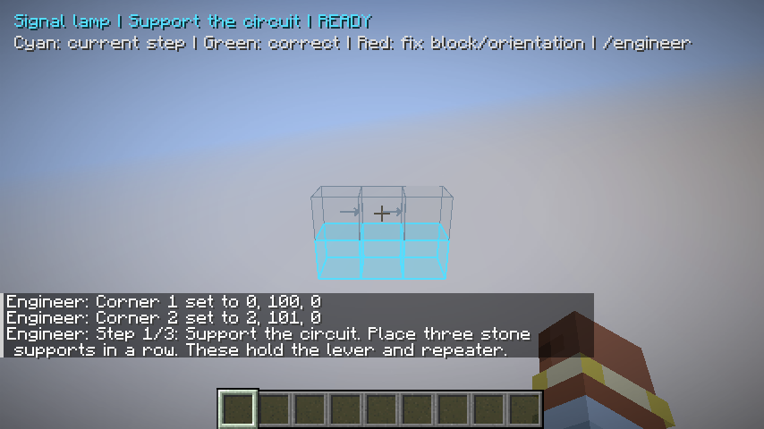
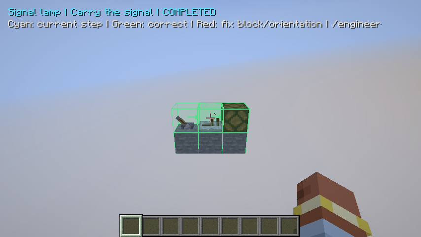
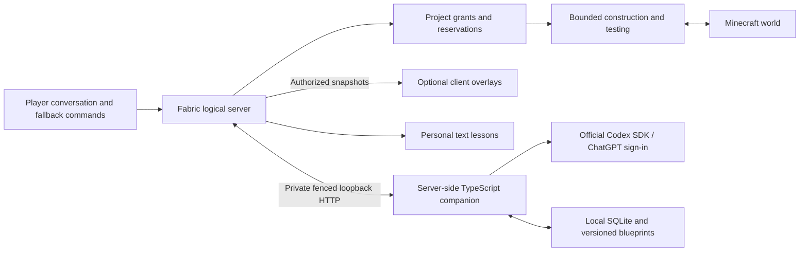

# Minecraft AI Engineer

A local-first engineering partner for Minecraft Java: **show me, teach me,
take over, test it, and remember what we're building.**

The source build provides bounded creative-mode workflows for a signal lamp,
inverter, two-input OR gate, observer pulse and canonical piston shutter: preview,
teach, delegate, diagnose, explicitly
repair, undo and test actual redstone behavior. Bounded component hierarchies
support independent player/assistant work, with private inventory/material checks.
The source also supports separately confirmed raw generated buffers with actual
on/off transition timing tests; see the [generated flow](docs/mod-guide.md#generated-timed-buffers-source-build).
It also accepts complete named Boolean truth tables and tests every row forward
and backward with per-tick stability and safe input restoration; see
[Boolean logic](docs/mod-guide.md#generated-boolean-logic-source-build).
Compare/subtract [comparator workbenches](docs/comparators.md) add physical
strength selectors and a distinct server-side numeric test with original-input
restoration. Project setup and the main workflow use [normal addressed chat](docs/mod-guide.md#talking-to-engineer-development-source).
Larger engineering designs and broader features in the [product brief](docs/product-brief.md) are
still in development.
See [STATE.md](STATE.md) for evidence, limits and the next work.

**Multiplayer-first:** one dedicated Fabric server owns projects,
player permissions and construction. Authorized players share blueprints and
keep separate lessons; client overlays are optional. The same core also passes
integrated single-player checks. Follow the [dedicated-server guide](docs/mod-guide.md#multiplayer-development-branch).
The multiplayer development preview is available below.

## Installable build candidates

CI creates an `installable-preview` artifact containing a compiled companion zip,
matching mod jar, source/run identity and SHA256 checksums. Its companion runtime
is exercised after extraction on Linux and Windows, without a model request.
Use artifacts only from a successful main run with all five required checks;
PR artifacts are development candidates. Follow the bundled `START-HERE.md` or
[installation guide](docs/install.md). The published preview below comes from an
exact main run that passed all five required checks.

## Try it

Download the [multiplayer development preview v0.1.0-alpha.2](https://github.com/1xmint/minecraft-ai-engineer/releases/tag/v0.1.0-alpha.2).
Get its companion zip, matching mod jar, `BUILD.json` and `SHA256SUMS`, then follow
`START-HERE.md` inside the zip or the [installation guide](docs/install.md).
The companion contains compiled JavaScript: install its pinned runtime dependencies
with `npm ci --omit=dev`; no TypeScript or Java compiler is needed.

Use a disposable creative world on a dedicated local server. Minecraft Java
**26.3**, Fabric Loader **0.20.1**, Fabric API **0.165.0+26.3**, Java **25** and
Node **24.14.0** are pinned. Run one private companion beside the server with the
same data directory. Keep `online-mode=true`; this preview's CI uses scripted
offline players and does not prove production account login or full human acceptance.

After following the server/operator setup in the installation guide:

1. Join `localhost` and say `Engineer, start a new project`.
2. Stand at the first workspace corner and say `Engineer, mark the first corner here`.
   Move to the opposite upper corner and say `Engineer, mark the second corner here`.
3. Say `Engineer, show me a signal lamp`, then `Engineer, explain how this works`.
4. Ask the bot to build or test when ready, and review its separate confirmation.
   Say `Engineer, stop` to interrupt work. A preview places no blocks.
5. Save a requirement with `Engineer, remember my preference: Keep the wiring visible.`
   Ask `Engineer, what do you remember about this project?` to read shared notes.

Codex reasoning uses the configured account-owning operator's ChatGPT sign-in and
subscription quota. No API key or separately billed API service is used. Other
members never receive that login or direct model access. Current source adds
offline voice drafts/private spoken replies and physical survival work, including
a companion that builds and tests a NOT gate and two companions working at once.
Alpha.2 predates these additions. The [release notes](docs/release-notes.md) list
what alpha.3 supports, what it does not, and the human checks still open.

The [companion guide](docs/companion-guide.md) covers configuration and memory.
The [mod guide](docs/mod-guide.md) covers sharing, lessons, conflict protection,
undo and restart. Commands remain a manual fallback. The older
[solo alpha.1](https://github.com/1xmint/minecraft-ai-engineer/releases/tag/v0.1.0-alpha.1)
is retained as a historical reference.

## What the preview supports

- Exact block-state inspection of a selected region, including orientation.
- Translucent block-bound previews with names, direction arrows, current-step
  highlighting and mistake detection.
- Staged teaching with actual placement checks and automatic advancement.
- Explicit delegation inside the selection, paced creative placement, emergency
  stop, reconciliation on resume, and conflict-aware bounded undo.
- A curated lever/repeater/lamp design selected through the official Codex SDK.
  Unsupported engineering requests are reported honestly.
- SQLite project memory, immutable blueprint revisions, observations, audit
  records and checkpoints outside your world saves and repository.
- Actual Minecraft tick tests for reference circuit behavior. Geometry matches
  and model explanations never count as functional verification.

Broader mechanism generation, large component projects, deeper world-aware
redstone debugging and broad revision propagation remain phase 1 work. Voice,
a visible NPC companion, survival gathering, schematic exchange, advanced
optimization and multiple builders belong to **phase 2**.

## How it fits together

The companion proposes data. The mod validates it against Minecraft's block
registry and owns permission checks and world writes. Existing incorrect
blocks, inventories, unloaded chunks, conflicting edits and out-of-region
targets block construction. Local world data stays local except the bounded
engineering request and selected project context sent to Codex for planning.

Windows stores private data in `%APPDATA%\minecraft-ai-engineer`; Linux/macOS
use `~/.config/minecraft-ai-engineer` (or `XDG_CONFIG_HOME`). `MCE_CONFIG_DIR`
can override the directory for both components. Keep it private: it contains
the local service token. Codex manages its own authentication storage.

## Develop with humans or coding agents

Start with [AGENTS.md](AGENTS.md), [STATE.md](STATE.md), and
[CONTRIBUTING.md](CONTRIBUTING.md). The repo separates `companion/`, `mod/`,
`tests/` and `docs/`; the exact localhost contract is in
[docs/protocol.md](docs/protocol.md). Claude reads the same instructions through
`CLAUDE.md`.

Use small PRs. `main` requires CI, linear history and resolved conversations,
including for the owner. Dependencies and Actions are pinned. Dependabot,
secret scanning, push protection, private vulnerability reporting and an
ownership file are configured. There are no model credentials in public CI.

Locally, use `npm run check`, `npm run format`, and scoped Java compilation.
GitHub CI runs the tests, including actual Minecraft and Windows process
checks. CI artifacts preserve build/test evidence. Read [SECURITY.md](SECURITY.md)
before experimenting with an existing save.

## Sources and license

The version choice follows [Fabric's 26.3 release guidance](https://fabricmc.net/2026/09/15/263.html).
The integration uses the [official Codex SDK](https://learn.chatgpt.com/docs/codex-sdk)
and [supported ChatGPT authentication](https://learn.chatgpt.com/docs/auth).
Subscription access remains subject to account availability and limits.

MIT license. This project is not affiliated with Mojang, Microsoft or OpenAI.
Minecraft game files and assets are not distributed in this repository.
