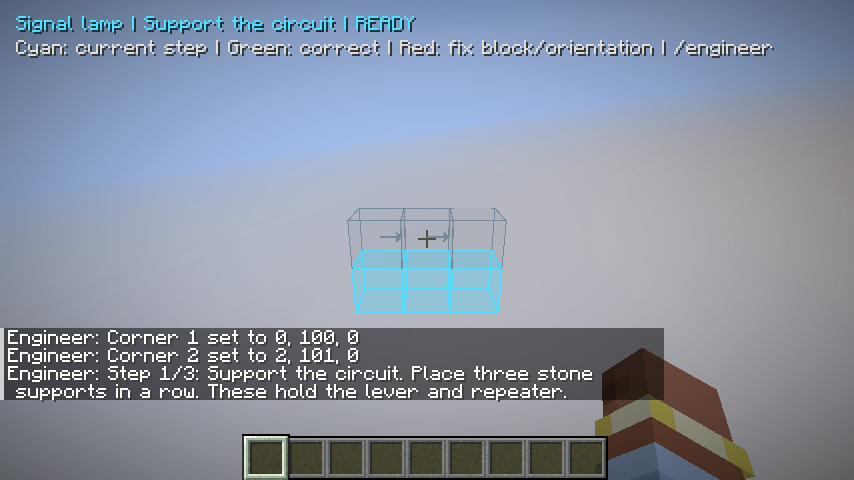
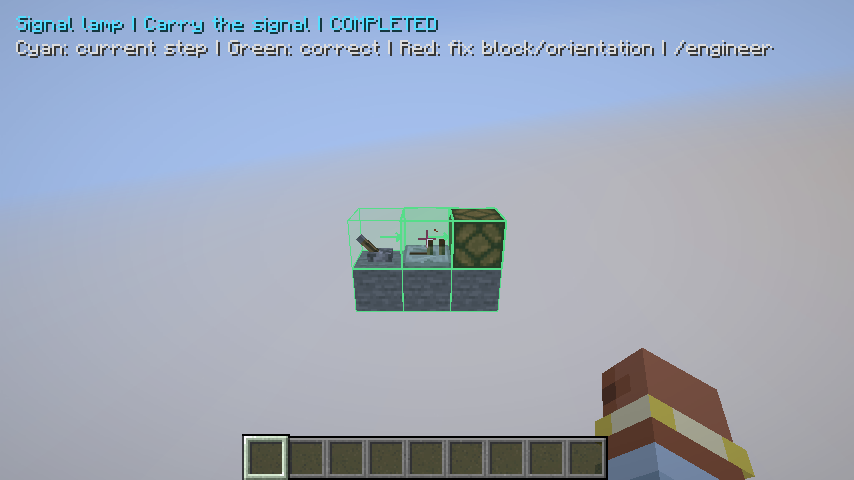
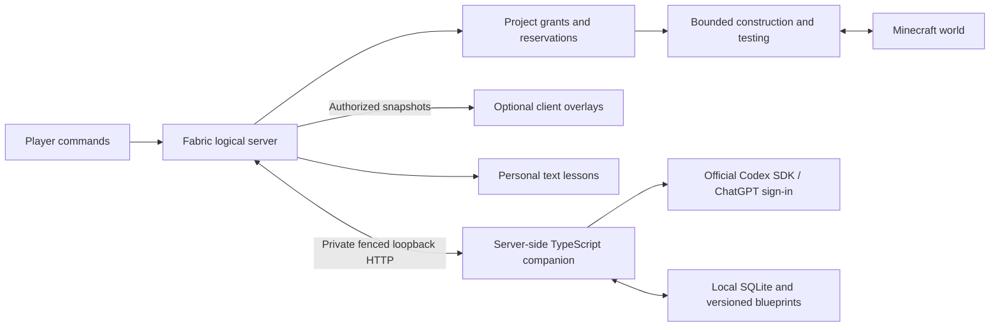

# Minecraft AI Engineer

A local-first engineering partner for Minecraft Java: **show me, teach me,
take over, test it, and remember what we're building.**

The source build provides bounded creative-mode workflows for a signal lamp,
inverter and two-input OR gate: preview, teach, delegate, diagnose, explicitly
repair, undo and test actual redstone behavior. Bounded component hierarchies
support independent player/assistant work, with private inventory/material checks.
The source also supports separately confirmed raw generated buffers with actual
on/off transition timing tests; see the [generated flow](docs/mod-guide.md#generated-timed-buffers-source-build).
Larger engineering designs and broader features in the [product brief](docs/product-brief.md) are
still in development.
See [STATE.md](STATE.md) for evidence, limits and the next work.

**Multiplayer-first source build:** one dedicated Fabric server owns projects,
player permissions and construction. Authorized players share blueprints and
keep separate lessons; client overlays are optional. The same core also passes
integrated single-player checks. Follow the [dedicated-server guide](docs/mod-guide.md#multiplayer-development-branch).
The downloadable alpha below is still the older single-player reference.

## Try it

For the multiplayer source build, start with the [dedicated-server instructions](docs/mod-guide.md#multiplayer-development-branch).
The following download and walkthrough describe the published solo alpha.

Start with the [downloadable development preview](https://github.com/1xmint/minecraft-ai-engineer/releases/tag/v0.1.0-alpha.1):
get the mod jar and companion zip, then follow `START-HERE.txt` inside the zip.
The companion bundle already contains compiled JavaScript; no TypeScript or
Java compiler is needed to run that bundle. The steps below launch from source.

Use a disposable single-player creative world with commands enabled. Minecraft
Java **26.3**, Fabric Loader **0.20.1**, Fabric API **0.165.0+26.3**, Java **25**
and Node **24.14.0** are pinned. Remote/LAN worlds and survival construction are
not supported.

1. Sign in to the official Codex CLI using **ChatGPT** (`codex login`). No API key
   or separately billed service is used. Planning consumes your subscription's
   available quota.
2. In this repo, run `npm ci`, `npm run build`, then `npm run doctor`.
   `npm run doctor -- --probe` checks one real structured model request.
3. Run `npm start` and leave it running.
4. In another terminal, run `cd mod` and `./gradlew runClient` on Linux/macOS,
   or `.\gradlew.bat runClient` on Windows, with Java 25 selected. Create a
   disposable creative world. Development uses its own game directory.
5. Use `/engineer help` and follow the [reference handoff walkthrough](docs/mod-guide.md#reference-handoff-flow).

The [companion guide](docs/companion-guide.md) explains account limits,
configuration and memory. The [mod guide](docs/mod-guide.md) includes installation
in a matching Fabric launcher profile, commands, undo and restart behavior.

## What the reference supports

- Exact block-state inspection of a selected region, including orientation.
- Translucent block-bound previews with names, direction arrows, current-step
  highlighting and mistake detection.
- Staged teaching with actual placement checks and automatic advancement.
- Explicit delegation inside the selection, paced creative placement, emergency
  stop, reconciliation on resume, and conflict-aware bounded undo.
- A curated lever/repeater/lamp design selected through the official Codex SDK.
  Unsupported engineering requests are reported honestly.
- SQLite project memory, immutable blueprint revisions, observations, audit
  records and checkpoints outside your world saves and repository.
- Actual Minecraft tick tests for reference circuit behavior. Geometry matches
  and model explanations never count as functional verification.

General mechanism generation, large component projects, deeper world-aware
redstone debugging and broad revision propagation remain phase 1 work. Voice,
a visible NPC companion, survival gathering, schematic exchange, advanced
optimization and multiple builders belong to **phase 2**.

## How it fits together

The companion proposes data. The mod validates it against Minecraft's block
registry and owns permission checks and world writes. Existing incorrect
blocks, inventories, unloaded chunks, conflicting edits and out-of-region
targets block construction. Local world data stays local except the bounded
engineering request and selected project context sent to Codex for planning.

Windows stores private data in `%APPDATA%\minecraft-ai-engineer`; Linux/macOS
use `~/.config/minecraft-ai-engineer` (or `XDG_CONFIG_HOME`). `MCE_CONFIG_DIR`
can override the directory for both components. Keep it private: it contains
the local service token. Codex manages its own authentication storage.

## Develop with humans or coding agents

Start with [AGENTS.md](AGENTS.md), [STATE.md](STATE.md), and
[CONTRIBUTING.md](CONTRIBUTING.md). The repo separates `companion/`, `mod/`,
`tests/` and `docs/`; the exact localhost contract is in
[docs/protocol.md](docs/protocol.md). Claude reads the same instructions through
`CLAUDE.md`.

Use small PRs. `main` requires CI, linear history and resolved conversations,
including for the owner. Dependencies and Actions are pinned. Dependabot,
secret scanning, push protection, private vulnerability reporting and an
ownership file are configured. There are no model credentials in public CI.

Locally, use `npm run check`, `npm run format`, and scoped Java compilation.
GitHub CI runs the tests, including actual Minecraft and Windows process
checks. CI artifacts preserve build/test evidence. Read [SECURITY.md](SECURITY.md)
before experimenting with an existing save.

## Sources and license

The version choice follows [Fabric's 26.3 release guidance](https://fabricmc.net/2026/09/15/263.html).
The integration uses the [official Codex SDK](https://learn.chatgpt.com/docs/codex-sdk)
and [supported ChatGPT authentication](https://learn.chatgpt.com/docs/auth).
Subscription access remains subject to account availability and limits.

MIT license. This project is not affiliated with Mojang, Microsoft or OpenAI.
Minecraft game files and assets are not distributed in this repository.
