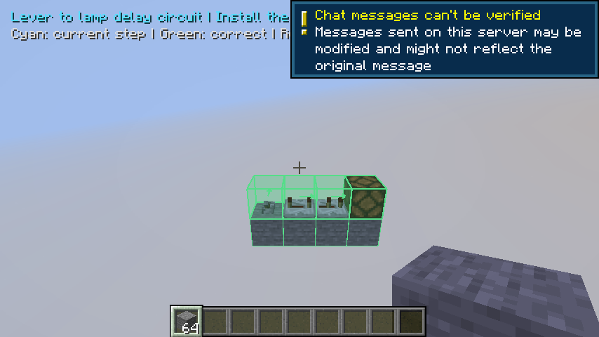

# Manual signed-in game acceptance

This developer flow connects one explicitly chosen synthetic GitHub Minecraft
run with the operator's existing local Codex sign-in. It is separate from normal
CI, which never invokes Codex. The workflows must first be merged onto the default
branch; their publication alone does not prove the combined flow works.

## Run it

Use the repository owner's GitHub CLI session and a clean reviewed checkout of
this repository. Install the pinned Node dependencies. Keep the existing Codex
ChatGPT sign-in local; no API key or login file is uploaded.

1. Start `live-acceptance.yml` manually on the reviewed ref, for example
   `gh workflow run live-acceptance.yml --ref main`.
2. Read its run ID, source SHA and attempt using GitHub's run page or
   `gh api repos/1xmint/minecraft-ai-engineer/actions/runs/RUN_ID`.
   Use a clean local checkout at that exact SHA.
3. Once its request artifact is available, run:

   ```text
   node scripts/acceptance/respond.mjs --run RUN_ID --attempt ATTEMPT --sha REVIEWED_SHA --model gpt-6-luna
   ```

   The command verifies source and GitHub provenance, compiles that reviewed
   TypeScript, reconstructs the allowed request, then makes one isolated SDK call.
   It saves the validated answer privately before dispatching the response workflow.

4. Inspect the request workflow's final status and `live-game-acceptance-evidence`
   artifact. Both the model-design marker and actual client construction,
   delegation, conflict, truth-table and service/game restart proofs must pass.
   Compare request/result digests and the provider receipt; a model response alone
   is not functional evidence.

The request expires after 15 minutes. Only the fixed synthetic lamp scenario is
supported. GitHub receives bounded fixture IDs, a validated plan and minimal usage
metadata, never personal credentials, SDK events or real project context. Normal
server permissions, immutable context checks and proposal validation still apply.
A successful lamp flow does not establish general design generation or complete
phase 1.

## Generated buffer flow (development)

Run `gh workflow run live-acceptance.yml --ref REVIEWED_BRANCH -f scenario=generated`
from a clean checkout at that exact source SHA. This chooses two separate model
calls through the normal native design/confirm commands, rather than catalog
selection. Once each corresponding request artifact appears, run:

```text
node scripts/acceptance/respond.mjs --run RUN_ID --attempt ATTEMPT --sha SOURCE_SHA --model gpt-6-luna --stage behavior
node scripts/acceptance/respond.mjs --run RUN_ID --attempt ATTEMPT --sha SOURCE_SHA --model gpt-6-luna --stage geometry
```

Wait for the geometry artifact before the second command. Each stage has its own
exclusive private started/response receipt and request/result digest. The native
owner confirms only the originally requested twelve-game-tick on and sixteen-
game-tick off behavior; the geometry call retains that accepted intent. The
pending native confirmation expires after five minutes, so respond promptly.
No credentials are uploaded and ordinary CI continues to use deterministic data.

The native flow previews the actual raw model response, places one support with
a real client action, delegates the remaining blocks, measures both transitions,
restarts the companion, shares and revokes Bob's preview/lesson, and reloads the
world with passing evidence marked stale. Inspect `live-generated-model.done`,
`player-generated-section.done`, both generated confirmation/recovery markers,
separate accepted receipts, and the actual generated restart screenshot. A live
model result or published artifact alone proves none of these game behaviors.
This fixed synthetic buffer flow does not establish broader engineering or phase2.

## Recorded proof

The fixed lamp path passed on reviewed source `a64f352` in
[request run40624276545](https://github.com/1xmint/minecraft-ai-engineer/actions/runs/40624276545)
and [response run40624742436](https://github.com/1xmint/minecraft-ai-engineer/actions/runs/40624742436).
One local signed-in SDK call returned delay1/rotation0; matching request/result
receipts link it to real client construction, actual redstone tests and service/
game restart evidence. This proves that fixed path, not general engineering,
natural follow-up revisions or the entire phase1 brief.

## Recorded generated proof and regression replay

Source `00e5da5` in [request run40766098371](https://github.com/1xmint/minecraft-ai-engineer/actions/runs/40766098371)
used two local signed-in SDK0.164.0/gpt-6-luna calls. Behavior response
[40766960852](https://github.com/1xmint/minecraft-ai-engineer/actions/runs/40766960852)
returned the requested12/16 contract; geometry response
[40767111851](https://github.com/1xmint/minecraft-ai-engineer/actions/runs/40767111851)
returned two serial repeaters with delays4+2, rather than a catalog selection.
Native construction, both actual edge traces, shared preview/lesson revocation,
companion restart and third game boot all passed their retained markers. The
restart screenshot visibly contains the constructed blocks.

That manual run's **overall result failed** afterward: its creative player-item
fixture left64 stone in the held slot, while an earlier inventory recovery proof
correctly expected the original7. The cleanup fix restores the exact prior held
stack/components. Ordinary CI replays the recorded raw reply from
`tests/fixtures/live-generated-buffer.json`, drives the same player support and
remaining AI construction, and checks the complete post-restart inventory flow.
This replay performs no new inference and does not claim a fresh signed-in call.
No production geometry, behavior, timing or authorization code changed for this
fixture cleanup. Do not label the original manual run as a successful whole run.



## Interrupted publication

A durable started receipt prevents a second SDK call for the same request. If the
answer was saved but publication failed, use the printed response path with the
same explicit run, attempt, SHA and model:

```text
node scripts/acceptance/respond.mjs --run RUN_ID --attempt ATTEMPT --sha REVIEWED_SHA --model gpt-6-luna --publish SAVED_RESPONSE_FILE
```

This only republishes the validated saved answer while its original run/context
remains live. It never invokes the model again. An expired run needs a new manual
run. No automatic model fallback or retry is performed.

## Existing-circuit structural modification (development)

The separate `structural` scenario starts with an explicit hand-authored
four-wide, two-repeater reference. It is not a new model design. The real player
places its first support, AI builds the remainder, and the original12/16 behavior
is tested before asking Codex to replace the two repeaters with three two-tick
repeaters in an explicitly expanded five-wide workspace.

Dispatch `live-acceptance.yml` with `scenario=structural` on the exact clean source
branch. Respond to each stage only after its corresponding request artifact exists:

```text
node scripts/acceptance/respond.mjs --run RUN_ID --attempt ATTEMPT --sha SOURCE_SHA --model gpt-6-luna --stage behavior --scenario structural
node scripts/acceptance/respond.mjs --run RUN_ID --attempt ATTEMPT --sha SOURCE_SHA --model gpt-6-luna --stage geometry --scenario structural
```

Both calls remain local, explicit and separately receipted. The fixed scenario,
request, completed-seed memory, five-wide bounds, run/SHA and stage are validated;
arbitrary CI inputs and private world memory are not accepted. The existing
four-wide generated scenario remains separate. Do not retry a consumed receipt.

The new native path reviews the actual model diff before a separate owner apply,
stops after a real write, places and removes a conflicting glass block through the
actual player client, resumes, and tests real12/16 timing. It then restarts the
companion, exercises Bob's authorized lesson/revocation and reloads the game.
Inspect both stage receipts, `live-structural-before`, `live-structural-after`,
`live-structural-model.done`, `live-structural-recovery.done`, and screenshot
`engineer-live-structural-restarted-build`. This source compiles but the actual
signed-in run has not yet been performed; do not label the scenario proven from
unit tests or the older generated acceptance run.
