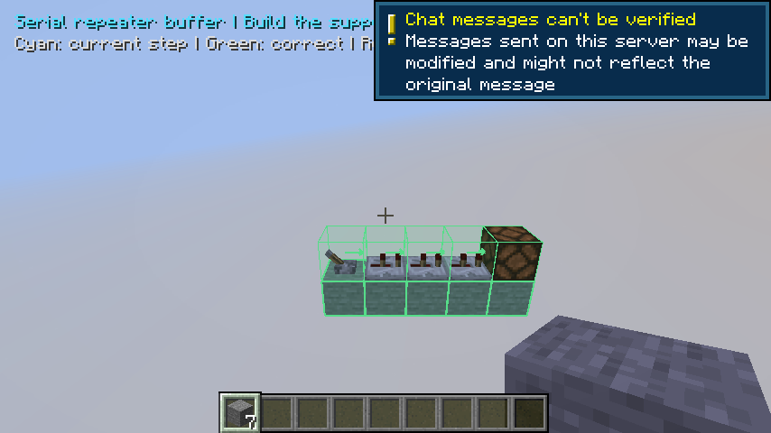
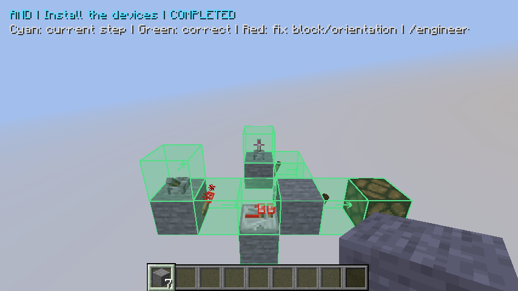

# Manual signed-in game acceptance

This developer flow connects one explicitly chosen synthetic GitHub Minecraft
run with the operator's existing local Codex sign-in. It is separate from normal
CI, which never invokes Codex. The workflows must first be merged onto the default
branch; their publication alone does not prove the combined flow works.

## Run it

Use the repository owner's GitHub CLI session and a clean reviewed checkout of
this repository. Install the pinned Node dependencies. Keep the existing Codex
ChatGPT sign-in local; no API key or login file is uploaded.

1. Start `live-acceptance.yml` manually on the reviewed ref, for example
   `gh workflow run live-acceptance.yml --ref main`.
2. Read its run ID, source SHA and attempt using GitHub's run page or
   `gh api repos/1xmint/minecraft-ai-engineer/actions/runs/RUN_ID`.
   Use a clean local checkout at that exact SHA.
3. Once its request artifact is available, run:

   ```text
   node scripts/acceptance/respond.mjs --run RUN_ID --attempt ATTEMPT --sha REVIEWED_SHA --model gpt-6-luna
   ```

   The command verifies source and GitHub provenance, compiles that reviewed
   TypeScript, reconstructs the allowed request, then makes one isolated SDK call.
   It saves the validated answer privately before dispatching the response workflow.

4. Inspect the request workflow's final status and `live-game-acceptance-evidence`
   artifact. Both the model-design marker and actual client construction,
   delegation, conflict, truth-table and service/game restart proofs must pass.
   Compare request/result digests and the provider receipt; a model response alone
   is not functional evidence.

The request expires after 15 minutes. Only the fixed synthetic lamp scenario is
supported. GitHub receives bounded fixture IDs, a validated plan and minimal usage
metadata, never personal credentials, SDK events or real project context. Normal
server permissions, immutable context checks and proposal validation still apply.
A successful lamp flow does not establish general design generation or complete
phase 1.

## Generated buffer flow (development)

Run `gh workflow run live-acceptance.yml --ref REVIEWED_BRANCH -f scenario=generated`
from a clean checkout at that exact source SHA. This chooses two separate model
calls through the normal native design/confirm commands, rather than catalog
selection. Once each corresponding request artifact appears, run:

```text
node scripts/acceptance/respond.mjs --run RUN_ID --attempt ATTEMPT --sha SOURCE_SHA --model gpt-6-luna --stage behavior
node scripts/acceptance/respond.mjs --run RUN_ID --attempt ATTEMPT --sha SOURCE_SHA --model gpt-6-luna --stage geometry
```

Wait for the geometry artifact before the second command. Each stage has its own
exclusive private started/response receipt and request/result digest. The native
owner confirms only the originally requested twelve-game-tick on and sixteen-
game-tick off behavior; the geometry call retains that accepted intent. The
pending native confirmation expires after five minutes, so respond promptly.
No credentials are uploaded and ordinary CI continues to use deterministic data.

The native flow previews the actual raw model response, places one support with
a real client action, delegates the remaining blocks, measures both transitions,
restarts the companion, shares and revokes Bob's preview/lesson, and reloads the
world with passing evidence marked stale. Inspect `live-generated-model.done`,
`player-generated-section.done`, both generated confirmation/recovery markers,
separate accepted receipts, and the actual generated restart screenshot. A live
model result or published artifact alone proves none of these game behaviors.
This fixed synthetic buffer flow does not establish broader engineering or phase2.

## Recorded proof

The fixed lamp path passed on reviewed source `a64f352` in
[request run40624276545](https://github.com/1xmint/minecraft-ai-engineer/actions/runs/40624276545)
and [response run40624742436](https://github.com/1xmint/minecraft-ai-engineer/actions/runs/40624742436).
One local signed-in SDK call returned delay1/rotation0; matching request/result
receipts link it to real client construction, actual redstone tests and service/
game restart evidence. This proves that fixed path, not general engineering,
natural follow-up revisions or the entire phase1 brief.

## Recorded generated proof and regression replay

Source `00e5da5` in [request run40766098371](https://github.com/1xmint/minecraft-ai-engineer/actions/runs/40766098371)
used two local signed-in SDK0.164.0/gpt-6-luna calls. Behavior response
[40766960852](https://github.com/1xmint/minecraft-ai-engineer/actions/runs/40766960852)
returned the requested12/16 contract; geometry response
[40767111851](https://github.com/1xmint/minecraft-ai-engineer/actions/runs/40767111851)
returned two serial repeaters with delays4+2, rather than a catalog selection.
Native construction, both actual edge traces, shared preview/lesson revocation,
companion restart and third game boot all passed their retained markers. The
restart screenshot visibly contains the constructed blocks.

That manual run's **overall result failed** afterward: its creative player-item
fixture left64 stone in the held slot, while an earlier inventory recovery proof
correctly expected the original7. The cleanup fix restores the exact prior held
stack/components. Ordinary CI replays the recorded raw reply from
`tests/fixtures/live-generated-buffer.json`, drives the same player support and
remaining AI construction, and checks the complete post-restart inventory flow.
This replay performs no new inference and does not claim a fresh signed-in call.
No production geometry, behavior, timing or authorization code changed for this
fixture cleanup. Do not label the original manual run as a successful whole run.


## Interrupted publication

A durable started receipt prevents a second SDK call for the same request. If the
answer was saved but publication failed, use the printed response path with the
same explicit run, attempt, SHA and model:

```text
node scripts/acceptance/respond.mjs --run RUN_ID --attempt ATTEMPT --sha REVIEWED_SHA --model gpt-6-luna --publish SAVED_RESPONSE_FILE
```

This only republishes the validated saved answer while its original run/context
remains live. It never invokes the model again. An expired run needs a new manual
run. No automatic model fallback or retry is performed.

## Existing-circuit structural modification (development)

The separate `structural` scenario starts with an explicit hand-authored
four-wide, two-repeater reference. It is not a new model design. The real player
places its first support, AI builds the remainder, and the original12/16 behavior
is tested before asking Codex to replace the two repeaters with three two-tick
repeaters in an explicitly expanded five-wide workspace.

Dispatch `live-acceptance.yml` with `scenario=structural` on the exact clean source
branch. Respond to each stage only after its corresponding request artifact exists:

```text
node scripts/acceptance/respond.mjs --run RUN_ID --attempt ATTEMPT --sha SOURCE_SHA --model gpt-6-luna --stage behavior --scenario structural
node scripts/acceptance/respond.mjs --run RUN_ID --attempt ATTEMPT --sha SOURCE_SHA --model gpt-6-luna --stage geometry --scenario structural
```

Both calls remain local, explicit and separately receipted. The fixed scenario,
request, completed-seed memory, five-wide bounds, run/SHA and stage are validated;
arbitrary CI inputs and private world memory are not accepted. The existing
four-wide generated scenario remains separate. Do not retry a consumed receipt.

The new native path reviews the actual model diff before a separate owner apply,
stops after a real write, places and removes a conflicting glass block through the
actual player client, resumes, and tests real12/16 timing. It then restarts the
companion, exercises Bob's authorized lesson/revocation and reloads the game.
Inspect both stage receipts, `live-structural-before`, `live-structural-after`,
`live-structural-model.done`, `live-structural-recovery.done`, and screenshot
`engineer-live-structural-restarted-build`. The first actual signed-in run40805062670
accepted both SDK replies and completed real stop/edit-conflict/resume, but the
model pointed all repeaters east and the actual lamp stayed off at tick12. That
run failed before restart acceptance. Its exact raw reply is retained in
`tests/fixtures/live-structural-reversed.json`; it has not been silently corrected.
Direction guidance and positive/negative Minecraft regressions address that cause
before one new bounded two-call run. Do not label the working scenario proven
from receipt acceptance, valid geometry, unit tests or the older generated run.

## Verified structural modification and deterministic replay

Source `ccd89d2` passed all five regression gates in
[CI40806790413](https://github.com/1xmint/minecraft-ai-engineer/actions/runs/40806790413).
The entire actual signed-in
[structural run40806992766](https://github.com/1xmint/minecraft-ai-engineer/actions/runs/40806992766)
then passed. Separate behavior response40807645397 and geometry response40807742547
preserved12/16 intent and returned three west-facing two-tick repeaters. The raw
reply was applied unchanged after separate owner confirmation.

The real player placed the reference's first support, AI completed it, and initial
timing passed. Actual stop/client glass edit/conflict/resolution/resume, new12/16
timing, companion process restart4537->5429, Bob's lesson/revocation and third game
boot all passed. Both accepted receipts match local request/result digests. The
inspected screenshot shows actual constructed blocks after restart:



`tests/fixtures/live-structural-buffer.json` retains the exact successful raw reply
and provenance. Ordinary CI replays it through real construction/testing without
new inference, while the earlier reversed reply remains a negative fixture. The
initial reference is hand-authored; this proves its live model modification, not
fresh initial generation, general engineering, human mouse use or Mojang sign-in.
The earlier failed run is still a failure; source-grounded direction guidance and
one new bounded run produced the successful result above.

## Complete Boolean design (source build)

The explicit `boolean` scenario requests a new AND design with named lever inputs
`a` and `b`, one lamp output, and a20-game-tick settling bound. It uses a fresh
6x3x4 workspace at400,100,0 and empty synthetic project memory. Existing buffer
and structural scenarios and their consumed receipts remain separate.

After required regression checks pass on the exact clean source branch, dispatch
`live-acceptance.yml` with `scenario=boolean`. Validate the actual first request
and its run/source/owner/stage binding before invoking the local responder. Each
command is one explicit bounded model call, only after its request artifact exists:

```text
node scripts/acceptance/respond.mjs --run RUN_ID --attempt ATTEMPT --sha SOURCE_SHA --model gpt-6-luna --stage behavior --scenario boolean
node scripts/acceptance/respond.mjs --run RUN_ID --attempt ATTEMPT --sha SOURCE_SHA --model gpt-6.1-sol --stage geometry --scenario boolean
```

The native owner checks the entire independently requested table before confirming
geometry. A proposal is not building authority. The flow uses the actual returned
layout, seeds its supports and two differently powered levers as an explicitly
synthetic existing player section, then delegates the remaining devices. It tests
all rows forward/reverse using every-tick stability, restarts the actual companion,
interrupts a second trial by revoking a grant, and boots the saved server again.
Fresh owner resume must restore both original inputs; a new trial must pass.

Retain and inspect both accepted receipts, `truth-accepted-source`,
`truth-interrupted.done`, `truth-recovery.done`, `live-boolean-model.done`,
`live-boolean-recovery.done` and screenshot
`engineer-live-boolean-restarted-build`. SQLite proof requires exactly two planning
starts and distinct completed trials before/after restart. Missing ticks are
inconclusive; a correct geometry or final reading alone cannot pass. Preserve
failed raw replies unchanged and never retry consumed started receipts.

The successful signed-in Boolean proof is recorded below. Existing hand-authored
AND physics/recovery evidence remains separate from fresh model inference. Synthetic support/lever
seeding is not human mouse placement, Mojang authentication or the full Phase1
player-built functional-component experience. Credentials remain local; no paid
API fallback or automatic model retry is used.

### First Boolean live attempt: failure retained

Source `ee2745f` passed all five required checks in
[CI40905604442](https://github.com/1xmint/minecraft-ai-engineer/actions/runs/40905604442).
The actual [Boolean attempt40906470078](https://github.com/1xmint/minecraft-ai-engineer/actions/runs/40906470078)
accepted the exact requested AND behavior from response40907741010, then the local
geometry validator rejected missing wall-lever backing. The raw explanation also
incorrectly treated serial repeaters as AND. No Boolean construction or functional
pass followed. The workflow was cancelled after this local rejection; it is not a
successful live acceptance. Both model-call receipts are consumed.

The unchanged failed reply and usage are retained in
`tests/fixtures/live-boolean-missing-support.json`. Geometry guidance now states
precise attachment rules and native-proven Boolean composition. Regression checks
and a new bounded receipt pair must establish whether that guidance produces a
working model design. A passing hand-authored AND remains separate evidence.

### Second Luna reply rejected; Sol geometry passed

Source `d3c8486` passed all five checks in
[CI40908760538](https://github.com/1xmint/minecraft-ai-engineer/actions/runs/40908760538).
The second Luna attempt40908843817 returned a torch and lamp at the same position;
local validation rejected it before construction. Its unchanged raw reply is
`tests/fixtures/live-boolean-overlap.json`; both receipts are consumed. The run was
cancelled after that rejection. No failed reply was silently repaired.

The full [signed-in Boolean run40910817937](https://github.com/1xmint/minecraft-ai-engineer/actions/runs/40910817937)
then passed on the same source and constraints. Behavior response40911887391 used
Luna; geometry response40912161087 used Sol. The actual13-block layout differs from
the hand-authored reference. Native confirmation, preview without edits, explicit
build, all8 forward/reverse cases, companion restart4778->5851, revoked interruption,
actual saved-server restart, fresh owner restoration and a second trial all passed.
Trials completed at16:30:43 and16:31:11. Both accepted request/result digests match
the exclusive local receipts. The inspected screenshot shows real blocks:



`tests/fixtures/live-boolean-and.json` retains the exact successful proposal/raw
geometry and separate model provenance. Ordinary CI replays that data, starting
untested and deriving the synthetic existing lever/backing section from its real
ports. Actual tests must establish behavior again; replay is not fresh inference.
The bounded result does not prove general engineering, human mouse placement or
Mojang authentication. All six Boolean calls across the three attempts are consumed.
Do not make further calls or reuse their exclusive started receipts for this slice.

## Grounded conversation proof (development branch)

The manual workflow also has a `discussion` scenario and stage. It creates a
synthetic unbuilt lamp project and the two fixed owner requirements about a
six-block entrance and visible output, then asks one explicit engineering
question. The bridge accepts only that exact intended design and those notes;
it never exports inventories, arbitrary project text or credentials.

After the reviewed source passes ordinary CI, dispatch the existing manual
workflow on that source with `scenario=discussion`. The existing local responder
uses `--scenario discussion --stage discussion` with explicit run, attempt, SHA
and `--model gpt-6-luna`. It makes one subscription-authenticated model call and
requires a bounded explanation citing both owner notes. Run/source/digest and
expiry checks bind the reply to the actual native question. A durable started
receipt forbids another inference attempt; publication can retry only an already
saved valid response. No automatic retry or paid API fallback exists.

The real native client must display that reply without building or inventing a
functional pass. Authorized sharing, denied editor authorship, revocation, an
actual companion process replacement and later game boot must preserve the
literal notes and unchanged blueprint/world evidence. Restart recovery reads
notes and appends a third constraint without another model call. The SQLite
verifier requires exactly one discussion dispatch and accepted answer. Ordinary
CI still uses explicit deterministic fixtures; those are not fresh inference.

Fresh discussion acceptance passed on source `b858364` (all five ordinary checks
in [CI40959246919](https://github.com/1xmint/minecraft-ai-engineer/actions/runs/40959246919)).
The entire [manual run40960496759](https://github.com/1xmint/minecraft-ai-engineer/actions/runs/40960496759)
succeeded; response workflow40961355992 published the one accepted Luna reply.
Official SDK0.164.0 used10919 input/140 output tokens. The actual Minecraft client
received the exact response at21:52:41 UTC, citing both owner notes, retaining the
six-block constraint and saying the reason for visibility was not recorded. It
explicitly stated that no evidence of construction or testing was supplied.

The whole native flow then passed editor read/denial, revocation, actual companion
process replacement4709->5253 and a later saved-server boot. Notes were read at
revision2 and extended to revision3 without another model call. SQLite required
exactly one discussion dispatch/answer and all three literal owner notes; world
blocks, blueprint revision and functional evidence stayed unchanged.

`tests/fixtures/live-discussion.json` retains the exact synthetic request/reply and
usage/digests as archival codec evidence. Its historical acceptance time is used
only by offline regression validation; it never authorizes another inference or
replays the old reply into a new project. Request digest
`2b1b24e69d36bfef9e32957cd6806b74b21e42b13d3e9c7efaafd792b4e80cb5`;
result digest `5a666a4b4fdf67b866c095230571455c0d03255009dda02b3c96f82654d248e6`.
The unchanged native screenshot is `docs/images/grounded-discussion.png`.
This bounded proof does not establish full natural action interpretation, general
engineering, Mojang authentication or shared multi-user subscription eligibility.
The single discussion call is consumed; no further SDK calls are needed for this
slice. Private started/untrusted/response receipts remain on the operator PC.

## Natural interpretation proof (development branch)

The manual workflow's `natural` scenario uses the `natural` stage and exactly one
fixed diagnosis question for the connected synthetic owner. The local responder
accepts `--scenario natural --stage natural` with the explicit run, attempt,
reviewed source SHA and model. Run it only after that source's deterministic checks
are green. CI carries bounded canonical project data; credentials and SDK execution
stay on the operator's PC. A started receipt remains consumed after failure or
cancellation; publish an already saved valid response rather than invoking again.

The accepted typed reply must choose diagnosis of the selected root component.
Native acceptance checks actual diagnosis, no world-action consent or execution
lease, denied editor model access, literal notes, a real companion replacement and
saved-server recovery without restoring a diagnosis proposal. Inspect
`live-natural-model.done`, `live-natural-recovery.done`, the SQLite proof and the
`engineer-natural-diagnosis` screenshot. This proves one fresh interpretation and
its native dispatch; synthetic routing tests are separate evidence. The fresh natural proof passed on source `8214fbd` in
[run41221809497](https://github.com/1xmint/minecraft-ai-engineer/actions/runs/41221809497),
following all five deterministic checks in run41221636372. Exactly one
GPT-6-Luna call used 11,519 input and 73 output tokens with SDK0.164.0. The native
flow completed in10m28s with both natural markers, actual companion replacement,
saved-server recovery and strict SQLite verification. The screenshot was inspected
and is saved as `docs/images/natural-diagnosis.png`.

`tests/fixtures/live-natural.json` archives the exact synthetic request/reply for
codec regression tests. It is expired historical evidence, never a fresh native
response or authority. The private started/untrusted/response receipts remain local.
This call is consumed; do not invoke it again or reuse older discussion receipts.
