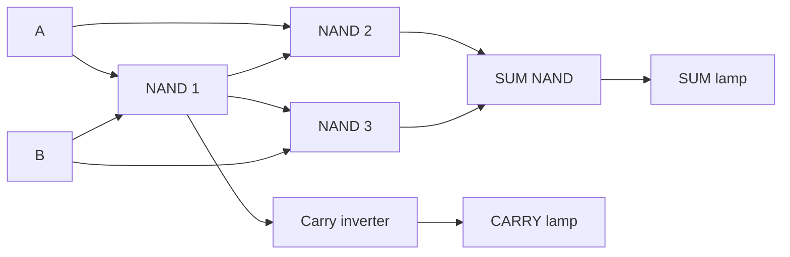

# Connected half-adder

This development branch adds a curated one-bit half-adder. The physical circuit
has native Minecraft proof in all four orientations. Full conversational,
multiplayer and restart checks are still pending; it is not in alpha.2.

Mark a workspace at least 46 blocks wide, 2 high and 37 deep using the normal
project conversation, then say **“Engineer, show me a half-adder.”** Previewing
does not place blocks or authorize construction. Ask how it works, follow its
five teaching stages, or ask the engineer to build and approve the proposed action.
Keep the surrounding two-block test margin clear and loaded.

The stages are supports, shared controls, logic gates, signal connections and
result lamps. Materials are 227 stone, 171 redstone dust, 25 repeaters, 9 redstone
torches, 2 levers and 2 lamps. Construction currently uses creative editing;
these counts do not imply survival gathering or inventory consumption.

Only A and B are external controls. Internal pins receive signals through actual
buffered routes; testing never toggles an internal pin as if it were a lever.

| A   | B   | SUM | CARRY |
| --- | --- | --- | ----- |
| off | off | off | off   |
| off | on  | on  | off   |
| on  | off | on  | off   |
| on  | on  | off | on    |

Ask the engineer to test the completed circuit. The intended test covers these
four rows forward and backward. It observes twenty physical pins on consecutive
game ticks, allows 48 ticks to settle, and requires eight stable samples for each
case. These are test-window requirements, not a measured propagation latency.
Both original lever states must be restored before a pass can be recorded.

A matching shape, an individual working gate or one correct lamp cannot certify
the whole circuit. Missing observations are inconclusive. A wrong observation
identifies its pin, expected state, actual value and clock. Correct the cause and
request a fresh test; imported or historical evidence cannot mint a current pass.

Human edits pause affected work. Undo preserves edits that differ from the
assistant's recorded states, including manual dust dots and lever changes. Native
wire-arm changes are accepted only within canonical, recorded assistant work.
Restart retains the design and history, but not a live pass or an execution lease.

This is the first connected design, not arbitrary circuit synthesis. Larger
arithmetic units, registers, memory, displays and computers remain roadmap work.
