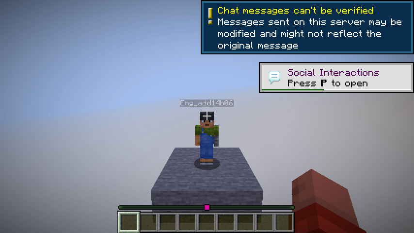

# Optional physical companion

This development feature has passed native lifecycle and dedicated two-client
chat proof; full integration checks remain pending. It is not included in alpha.2.
It currently creates an idle visible companion;
physical construction, gathering and navigation are not enabled.

Screenshot from the dedicated offline CI fixture on source `053f358`,
[run 41576664814](https://github.com/1xmint/minecraft-ai-engineer/actions/runs/41576664814).
The run proves addressed-chat summon/dismiss, denied shared-editor actions and
owner-disconnect cleanup. It does not establish production account login or the
full human acceptance workflow.

The [saved-server reboot proof](https://github.com/1xmint/minecraft-ai-engineer/actions/runs/41577467684)
on source `eb036d1` also passed: same saved world/project, new server epoch, no
automatic actor or action authority, then explicit chat creates a new actor that
reaches the reconnected client. This tests idle lifecycle recovery; interrupted
physical construction and inventory recovery remain unfinished.

The server operator needs the free
[Carpet 26.3 release](https://github.com/gnembon/fabric-carpet/releases/tag/v26.3),
specifically `fabric-carpet-26.3+v260915.jar`. Its SHA256 is
`7c40b93e807ed914064176898037117097446c6cc76e6a80a856c8bf7f7659f9`.
Install it in the dedicated Fabric server's mods folder. No extra account, API key
or client mod is needed. The ordinary Engineer works without this optional mod.

As project owner:

1. Select your project and mark a workspace containing a 3×3 stone floor with two
   clear air blocks above it, at the workspace's minimum corner.
2. Move players and other entities out of that space.
3. Say **“Engineer, summon my companion.”**
4. Say **“Engineer, where is my companion?”** for its position, or
   **“Engineer, dismiss my companion.”** to remove it.

A new companion starts as an empty survival actor with a generated `Eng_…` name. It has no
project permissions, cannot use items or mine without a separately checked action
ticket, and cannot pick up dropped materials or experience orbs while idle. Authorized project
viewers can ask for its location; only the owner can summon or dismiss it.

Changing the owner's connection, dimension, selected project, project revision or
permissions removes the actor. Moving it out of its idle position also removes
it. Server shutdown stops and removes it; restart does not automatically summon
it or grant any action authority. These lifecycle cases still require the stated
CI and multiplayer proofs before release.

Each project keeps a private worker identity. An explicit resummon reuses it and
loads native player data before joining; missing data or a conflicting connected
identity refuses the request. Saving reloads and compares inventory contents.
No permission, connection or action ticket is recovered. A resummoned actor retains its saved inventory. Gathering requires empty inventory; dirt placement requires exactly one retained dirt item. This does not
provide atomic recovery across inventory and world files after a hard crash.

Bounded dirt gathering (dedicated multiplayer CI proven): an owner can say
`Engineer, gather dirt at X Y Z`. The target must be two to four blocks from the
companion on one horizontal axis, at the same height, along a clear three-wide
stone-supported path entirely in the selected workspace. Only one dirt block is
handled per request; the inventory must start empty. The companion uses native
mining and walking, accepts only its captured native drop and verifies the saved
inventory. Dismissal stops the task; explicit resummon retains saved resources
without restoring action permission. Construction and general navigation remain
unfinished. Interrupted or failed records require inspection; no automatic retry,
creative compensation or atomic hard-crash recovery is provided.

Say `Engineer, what happened to my gathered resources?` for an owner-only,
read-only comparison of gather records, saved native inventory and currently
visible source/drop state. `inspect companion recovery` is an equivalent phrase.
Missing player data is reported as unavailable, never treated as an empty
inventory. A missing drop does not prove it was picked up. Inspection grants no
permission and never creates, removes, retries or compensates resources.

Development placement slice: say `Engineer, place retained dirt at X Y Z` as the
project owner. The companion must hold exactly one dirt item in its hotbar. The
target must be clear air above stone, within four blocks of its eyes, with its
neighbor/support reservation inside the workspace and no entity in the target.
It uses native survival right-click, consumes the retained item and verifies its
saved inventory. Native return evidence and an empty inventory are required;
matching geometry alone is insufficient. This is not a blueprint executor,
functional test, undo mechanism or atomic hard-crash transaction.

Development blueprint bridge: `Engineer, build the next blueprint block with
retained dirt` selects the next missing dirt cell in an accepted single-root
stone/dirt blueprint. Existing stone supports must already match; composite
scheduling and other materials remain unsupported. All intended cells must be
loaded in the workspace and matching or air before work starts. The executor
reserves the plan reads, rechecks preceding intended cells and the accepted
assignment, and uses the same native retained-item placement. It does not grant
ownership of matching preexisting blocks, fabricate creative undo history, mark
the blueprint completed or grant a functional pass.

Development job: say `Engineer, gather dirt and build this blueprint` after
summoning the companion. It handles up to 32 dirt cells in a single-root
stone/dirt blueprint whose stone supports already match. It observes candidate
dirt sources in the selected workspace at request time, gathers one real item,
places the next planned cell, and repeats. Sources must be reachable through the
bounded clear three-wide stone corridor near the next cell. One lateral block of
pickup drift is allowed inside that same reserved corridor. No teleport,
material supply or creative fallback is used. Dismissal, connection/grant changes,
plan edits or inaccessible resources stop the job. Matching geometry remains
untested; unfinished records do not restore actions after restart.

Say `Engineer, stop` or `Engineer, stop building` to stop physical work as well as
core work. Only the project owner can stop its active physical companion. The
worker's current inventory is saved and checked before it becomes idle. Unfinished
resource records remain available for inspection; stopping never recreates a
resource or resumes an old action. A new request is required to continue.

Bounded navigation (focused dedicated multiplayer CI proven; combined integration pending): the same gather request can plan a bounded flat route to a valid mining stance when the resource is beyond the straight corridor. The selected workspace must contain stone-supported walking cells, two clear body blocks and inert surroundings. Routes use native forward input, never teleport or cut through obstacles. Movement holds exclusive occupancy, not block-write authority; edits, entities, deviation or owner authority changes stop it. On arrival, a fresh narrow gather lease and native mine/pickup tickets are required. Stairs, jumps, hazards, mechanisms and general terrain remain unsupported. The blueprint travel flow below also uses these routes.

Bounded blueprint travel (focused dedicated multiplayer CI proven; combined integration pending): the one-request dirt blueprint job can now route to original resources beyond the build area, carry retained items back to an adjacent placement stance, and repeat. Every route reserves the blueprint's observed cells as read dependencies and retains the original owner, connection, plan and assignment checks. A changed intended cell stops the job. Routes close before fresh native mine or placement tickets are issued. The same flat stone-supported inert-terrain and material limits apply; general terrain, tools and crafting remain unfinished.

Development oak resource contract (gameplay CI pending): say 'Engineer, gather oak log at X Y Z'. Only one isolated oak log on the same clear, stone-supported flat path is supported. Logs beside leaves or other logs are refused; this is not yet tree harvesting. The requested source material and exact block state are checked before native mining, and only its one captured native log drop can be collected. Existing dirt records retain version1; oak records use a strict version2 contract for read-only inspection. Retained logs are saved through native player data, never supplied or converted into materials by direct inventory editing. Preloaded inventory refuses another gather. Oak placement, plank crafting, tools and natural forest navigation remain unfinished.
